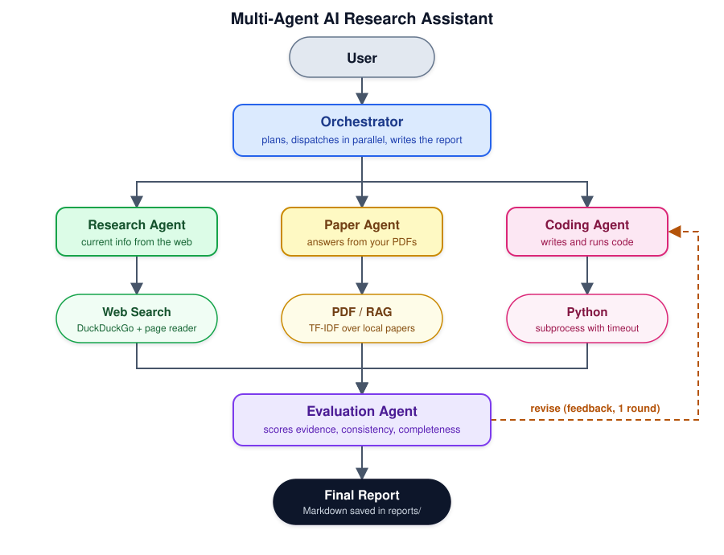
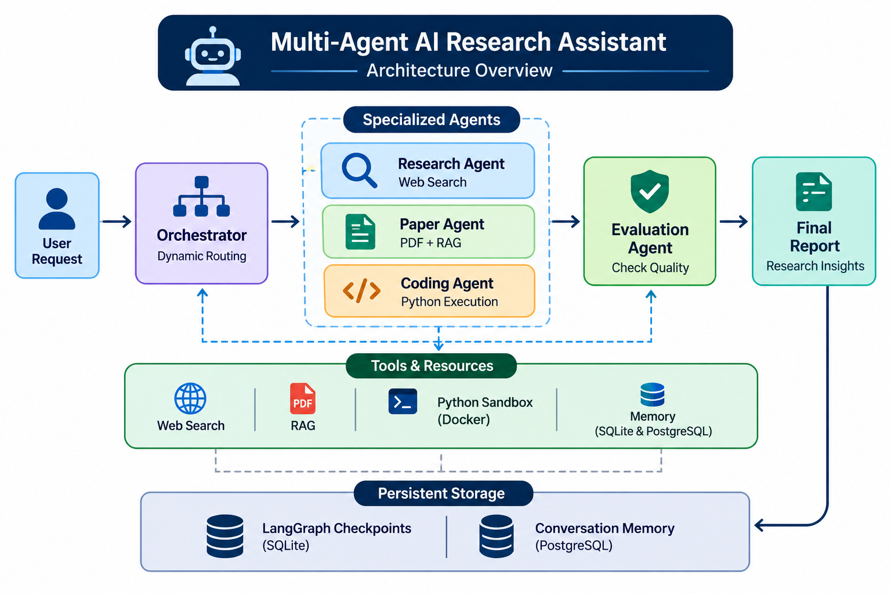

# Multi-Agent AI Research Assistant

An AI research assistant powered by **multi-agent workflows, RAG, memory, and tools**. The system uses **LangGraph** to dynamically route research tasks to specialized agents for web research, paper analysis, Python execution, and evaluation.



---

## Overview

The **Multi-Agent AI Research Assistant** is a modular agentic AI system designed to automate different stages of a research workflow.

Instead of relying on a single LLM prompt, the system uses several specialized agents coordinated by a **LangGraph workflow**. Depending on the user's request, the orchestrator dynamically determines which agents and tools are required.

For example, a research request may be routed to:



The architecture is designed to demonstrate important concepts in modern **Agentic AI and LLM application development**, including:

- Multi-agent orchestration
- Dynamic workflow routing
- LLM tool calling
- Retrieval-Augmented Generation (RAG)
- Persistent memory
- Human-in-the-loop workflows
- Sandboxed code execution
- Agent evaluation
- API-based deployment
- Containerization

---

# Key Features

### Dynamic Multi-Agent Routing

The system does not always execute every agent.

The **Orchestrator Agent** analyzes the user's request and determines which specialized agents are required.

For example:

```text
"What are the latest developments in Vision Transformers?"
        ↓
Research Agent
        ↓
Evaluation Agent
        ↓
Final Report
```

While:

```text
"Analyze this research paper and compare it with another paper."
        ↓
Paper Agent
        ↓
RAG Retrieval
        ↓
Evaluation Agent
        ↓
Final Report
```

This makes the workflow more efficient than a fixed sequential pipeline.

---

### Research Agent

The Research Agent is responsible for retrieving external information using web-search tools.

Typical tasks include:

- Finding relevant information
- Collecting research sources
- Summarizing retrieved content
- Supporting research-oriented questions

The retrieved information is passed to subsequent agents when required.

---

### Paper Agent

The Paper Agent works with research papers and PDF documents.

The system supports:

1. PDF upload
2. Text extraction using **PyMuPDF**
3. Document chunking
4. Embedding generation
5. Vector storage
6. Semantic retrieval
7. Context-aware analysis

This allows the assistant to answer questions based on the content of uploaded research papers.

---

### Coding Agent

The Coding Agent generates Python code for tasks such as:

- Data analysis
- Numerical calculations
- Machine learning experiments
- Statistical analysis
- Research-related programming

Generated code is **not executed directly by the API process**.

Instead, it is executed inside a Docker-based sandbox with restricted resources.

---

### Human-in-the-Loop

Potentially sensitive actions can require human approval before execution.

For example:

```text
Coding Agent
     ↓
Generated Python Code
     ↓
Human Approval
     ↓
Approved?
   ↙     ↘
 Yes      No
  ↓        ↓
Execute   Stop / Feedback
```

The workflow uses **LangGraph interrupts** to pause execution and resume the same workflow after the user provides approval.

---

### Persistent Memory

The system maintains persistent conversation-related memory using PostgreSQL.

Memory can be associated with a specific `thread_id`, allowing the application to maintain state across multiple requests.

LangGraph checkpoints are also persisted using SQLite.

This provides two different persistence mechanisms:

```text
LangGraph State
      ↓
SQLite Checkpoints

Conversation Memory
      ↓
PostgreSQL
```

---

### Evaluation Agent

The Evaluation Agent reviews the outputs generated by other agents.

It can evaluate:

- Relevance
- Completeness
- Consistency
- Quality of generated results

The evaluation results are then used by the final reporting stage.


# Agent Responsibilities

| Component | Responsibility |
|---|---|
| Orchestrator | Understands the request and selects the required workflow |
| Research Agent | Searches and analyzes external information |
| Paper Agent | Retrieves and analyzes information from PDFs |
| Coding Agent | Generates Python code |
| Human Approval | Controls potentially sensitive code execution |
| Evaluation Agent | Evaluates intermediate results |
| Final Report Agent | Produces the final research response |

---

# Workflow

A typical request follows this process:

### 1. User Request

The user sends a research question to the API.

### 2. Orchestration

The Orchestrator determines the type of task and selects the required agents.

### 3. Agent Execution

Only the necessary agents are executed.

### 4. Tool Usage

Agents can use specialized tools such as:

- Web search
- PDF retrieval
- Vector search
- Python execution

### 5. Human Approval

If Python execution has been requested, the workflow can pause for human approval.

### 6. Evaluation

The Evaluation Agent reviews the generated results.

### 7. Final Report

The system combines the available results and generates a final response.


# Technology Stack

### Programming

- Python 3.11+

### Agent Framework

- LangGraph
- LangChain

### Large Language Models

- OpenAI-compatible LLM APIs
- LangChain model interfaces

### RAG

- PyMuPDF
- Chroma
- Embeddings
- Recursive text chunking

### Memory

- SQLite
- PostgreSQL
- LangGraph checkpoints

### API

- FastAPI
- Pydantic

### Execution

- Docker
- Sandboxed Python environment

### Testing

- pytest

### Observability

- LangSmith

---

# Setup

## Requirements

Before running the project, install:

- Python 3.11+
- Docker
- Docker Compose
- An LLM API key
- Required API keys for configured search/embedding services

---

## 1. Clone the Repository

```bash
git clone <your-repository-url>
cd multi_agent_research_assistant_v2
```

---

## 2. Create a Virtual Environment

```bash
python -m venv .venv
```

Activate it on Linux/macOS:

```bash
source .venv/bin/activate
```

On Windows:

```bash
.venv\Scripts\activate
```

---

## 3. Install Dependencies

```bash
pip install -r requirements.txt
```

---

## 4. Configure Environment Variables

Copy the example environment file:

```bash
cp .env.example .env
```

On Windows:

```powershell
copy .env.example .env
```

Then configure the required API keys and database settings.

Example:

```env
OPENAI_API_KEY=your_api_key
TAVILY_API_KEY=your_api_key

POSTGRES_HOST=localhost
POSTGRES_PORT=5432
POSTGRES_DB=research_assistant
POSTGRES_USER=postgres
POSTGRES_PASSWORD=postgres
```

---

# Running the Application

## Start PostgreSQL

```bash
docker compose up -d postgres
```

Check the running containers:

```bash
docker ps
```

---

## Build the Python Sandbox

The coding agent executes generated Python code inside a dedicated Docker image.

Build the sandbox:

```bash
docker build -t research-python-sandbox:latest ./sandbox
```

---

## Start the API

```bash
uvicorn app.main:app --reload
```

The API will be available at:

```text
http://127.0.0.1:8000
```

Interactive API documentation:

```text
http://127.0.0.1:8000/docs
```

---

# API Endpoints

## Research

```http
POST /api/research
```

Starts a research workflow.

Example request:

```json
{
  "thread_id": "research-001",
  "query": "Explain recent developments in AI agents",
  "execution_requested": false
}
```

---

## Resume Human Approval

```http
POST /api/research/{thread_id}/resume
```

Resumes a paused workflow after human approval.

Example:

```json
{
  "approved": true,
  "feedback": "The code is safe to execute."
}
```

---

## PDF Ingestion

```http
POST /api/papers/ingest
```

Uploads and processes a research paper.

The ingestion pipeline performs:

```text
PDF
 ↓
PyMuPDF
 ↓
Text Extraction
 ↓
Chunking
 ↓
Embeddings
 ↓
Chroma
```

---

## Memory

```http
GET /api/memory/{thread_id}
```

Retrieves stored memory associated with a conversation thread.

---

# PDF RAG Pipeline

The PDF RAG system allows research papers to be converted into searchable knowledge.

The pipeline is:

```text
Research Paper
      ↓
   PyMuPDF
      ↓
 Text Extraction
      ↓
   Chunking
      ↓
   Embeddings
      ↓
    Chroma
      ↓
Semantic Retrieval
      ↓
   LLM Context
```

This allows the Paper Agent to retrieve relevant sections of a document instead of sending the entire document to the LLM.

---

# Human-in-the-Loop Execution

When code execution is requested, the workflow can stop before execution.

```text
User Request
     ↓
Coding Agent
     ↓
Generate Code
     ↓
Human Approval
     │
     ├── Approved → Sandbox → Evaluation
     │
     └── Rejected → Feedback / Stop
```

The workflow maintains the same `thread_id`, allowing execution to continue from the interrupted state.

---

# Sandboxed Python Execution

Python code generated by the Coding Agent is executed inside a Docker container.

The sandbox uses several restrictions, including:

- No network access
- Limited CPU
- Limited memory
- Limited number of processes
- Read-only filesystem
- Temporary writable storage
- Non-root execution

Example execution architecture:

```text
Coding Agent
     ↓
Generated Python
     ↓
Docker Sandbox
     ↓
Execution
     ↓
stdout / stderr
     ↓
Evaluation Agent
```

The sandbox is intended as a **defense-in-depth development mechanism**, not as a guaranteed security boundary for hostile code.

---

# Persistent State and Memory

The system uses different persistence mechanisms for different purposes.

### LangGraph Checkpoints

SQLite stores workflow checkpoints, allowing the graph to maintain state across interruptions and resumes.

```text
LangGraph
    ↓
SQLite Checkpoint
```

### Conversation Memory

PostgreSQL stores persistent conversation-related memory.

```text
Conversation
     ↓
PostgreSQL
```

This separation allows workflow state and application memory to be managed independently.

---

# Evaluation

The Evaluation Agent analyzes the results produced by the workflow.

The evaluation stage can consider:

- Relevance
- Completeness
- Consistency
- Output quality

This provides an additional layer between agent execution and final report generation.

---

# Testing

Tests are located in:

```text
tests/
```

Run the test suite with:

```bash
pytest
```

For more detailed output:

```bash
pytest -v
```

---

# Docker

The project uses Docker for infrastructure and sandbox execution.

The main components include:

```text
Docker Compose
     │
     ├── PostgreSQL
     │
     └── API
            │
            └── Python Sandbox
```

The Python sandbox is built separately:

```bash
docker build -t research-python-sandbox:latest ./sandbox
```

---

# Security Considerations

The Python sandbox provides several restrictions, but it should **not be considered a complete security boundary against malicious or hostile code**.

In particular, the development Docker Compose configuration may mount the Docker socket:

```text
/var/run/docker.sock
```

Access to the Docker socket can provide substantial control over the host system.

Therefore, this configuration is intended primarily for **trusted local development and experimentation**.

For production systems executing untrusted code, a stronger isolation architecture should be considered, such as:

- Dedicated virtual machines
- gVisor
- Firecracker
- Managed code-execution sandboxes
- Separate execution services
- Network-level isolation

Additional production protections should also include:

- Authentication
- Authorization
- Rate limiting
- Input validation
- File-size restrictions
- Malware scanning
- Audit logging
- Resource quotas

---

# Current Limitations

This V2 implementation is primarily a **research and engineering prototype**.

Current limitations include:

- No production-grade authentication
- Limited security hardening
- No dedicated production execution service
- Basic agent evaluation
- Limited academic search integrations
- No advanced citation management
- PostgreSQL memory is structured rather than fully semantic
- No distributed task queue
- No production-scale observability pipeline

---

# Future Improvements

Potential V3 improvements include:

### Advanced Agent Orchestration

- Parallel agent execution
- More sophisticated planning
- Agent-to-agent communication
- Reflection and self-correction
- Iterative research loops

### Academic Research

- arXiv integration
- Semantic Scholar integration
- Crossref integration
- Citation extraction
- Citation-aware RAG
- Automatic bibliography generation

### Memory

- Long-term semantic memory
- Vector-based user memory
- Memory summarization
- User preference learning
- Memory relevance scoring

### Production Infrastructure

- Authentication and authorization
- Redis caching
- Background task queues
- Kubernetes deployment
- Dedicated sandbox service
- Better monitoring and logging

### Evaluation

- Automated agent evaluation
- LLM-as-a-judge
- Retrieval evaluation
- Citation correctness
- Research-answer quality metrics

---

# Example Use Cases

The system can be extended for several research-oriented tasks.

### Literature Review

```text
Research Question
      ↓
Academic Search
      ↓
Paper Retrieval
      ↓
RAG
      ↓
Comparison
      ↓
Literature Review
```

### Machine Learning Experiment

```text
Research Question
      ↓
Coding Agent
      ↓
Generate Experiment
      ↓
Human Approval
      ↓
Python Sandbox
      ↓
Evaluation
      ↓
Results
```

### Research Paper Analysis

```text
Upload Paper
      ↓
PDF Processing
      ↓
Vector Database
      ↓
Semantic Retrieval
      ↓
Paper Agent
      ↓
Summary / Analysis
```

---

# License

This project is intended for research, educational, and experimental purposes.

Add the appropriate license file before distributing the project publicly.

---

# Author

**Zaniar Sharifi**

Machine Learning Engineer | AI/ML Researcher

Research interests include:

- Machine Learning
- Generative AI
- Agentic AI
- AutoML
- Evolutionary Algorithms
- Computer Vision
- Explainable AI
- Neural Architecture Search